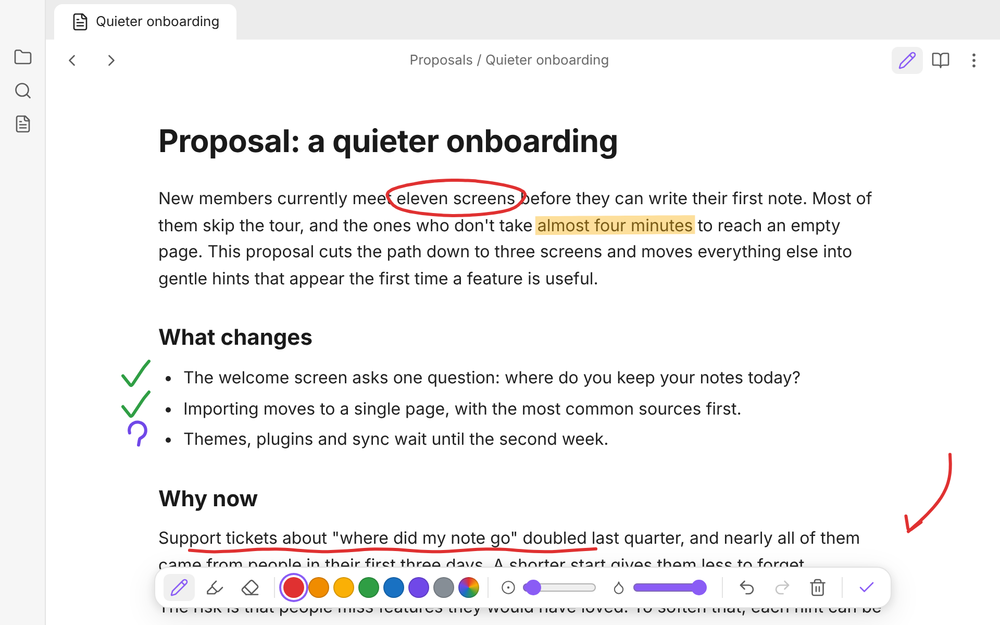
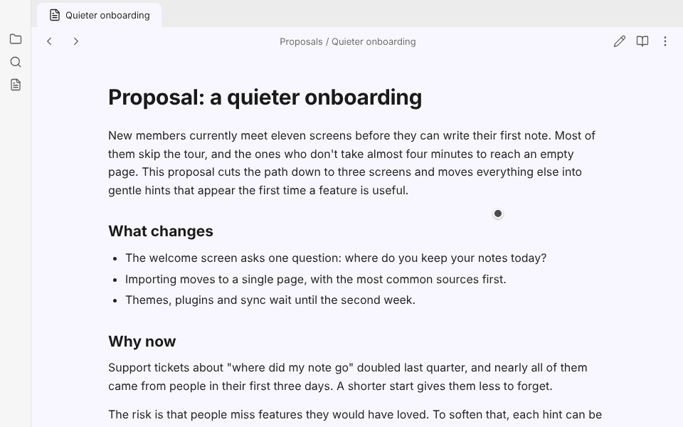
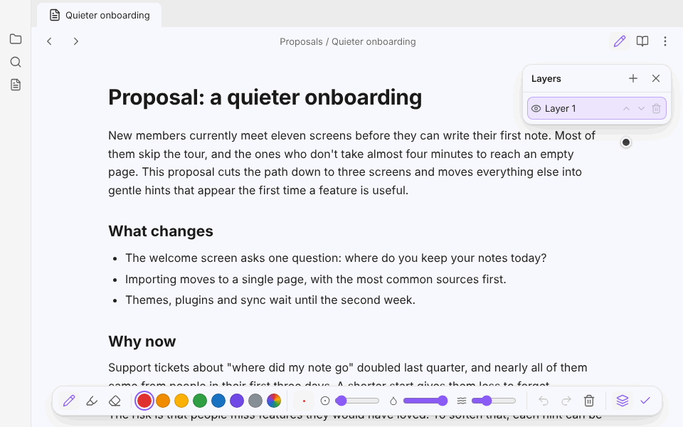

# Draw on Notes

Mark up your notes by hand, right where you read them. Click the pen, draw over the page, and keep reading.

## How it works

- **A pen on every note.** Click the pen icon at the top of a note to start drawing, and click it again, or press Esc, to go back to reading.
- **The whole page is yours.** Your drawing sits on top of the note and reaches into the margins, so you can circle a line, underline a word, or scribble beside a paragraph.
- **Quick marks while you review.** Tick off what's done, flag what needs another look, or draw an arrow, without leaving the note.
- **A pen, a highlighter and an eraser.** The highlighter has a flat tip and lets the text show through crisply, in light and dark themes. The eraser lifts off any stroke it touches, and so does the eraser end of a stylus.
- **Make the pen your own.** Seven colours, or any colour from the picker, and a size and transparency for each tool. Draw on Notes remembers them.
- **Undo anything.** Undo and redo every stroke, erase and clear.
- **Keep scrolling.** The mouse wheel still scrolls the note while you draw, and your marks scroll with it.
- **Out of the way.** When you're not drawing, your marks stay on the page and clicks go through to the note as usual. You can hide them in the settings.

## Shortcuts

While drawing:

| Key | |
| --- | --- |
| <kbd>P</kbd> <kbd>H</kbd> <kbd>E</kbd> | Pen, highlighter, eraser |
| <kbd>[</kbd> <kbd>]</kbd> | Smaller or bigger |
| <kbd>Ctrl</kbd>+<kbd>Z</kbd> | Undo |
| <kbd>Ctrl</kbd>+<kbd>Shift</kbd>+<kbd>Z</kbd> | Redo |
| <kbd>Esc</kbd> | Stop drawing |

On a Mac, use <kbd>Cmd</kbd> for <kbd>Ctrl</kbd>. To start drawing from the keyboard, give **Start or stop drawing on this note** a hotkey in Obsidian's settings.

## Where your drawings are kept

Your notes are never changed. Drawings are saved in the plugin's own `data.json`, by note, and they follow a note when you rename or move it.

Reading view and Editing view each keep their own drawings, since the same note is laid out differently in each. Marks stay where you drew them on the page, so if you later add or remove text above a mark, the text moves and the mark does not.

## Install

Draw on Notes isn't in the community plugin list yet. Until it is:

1. In your vault, make the folder `.obsidian/plugins/draw-on-notes`.
2. Put `main.js`, `manifest.json` and `styles.css` from this repository in it.
3. In Obsidian, open **Settings → Community plugins**, and turn on **Draw on Notes**.

## Support

Draw on Notes is made by one person in their spare time. If it saves you a printout or two, you can buy me a coffee, from the button at the top of the plugin's settings or here:

## License

Draw on Notes is under the [MIT](LICENSE) license.
